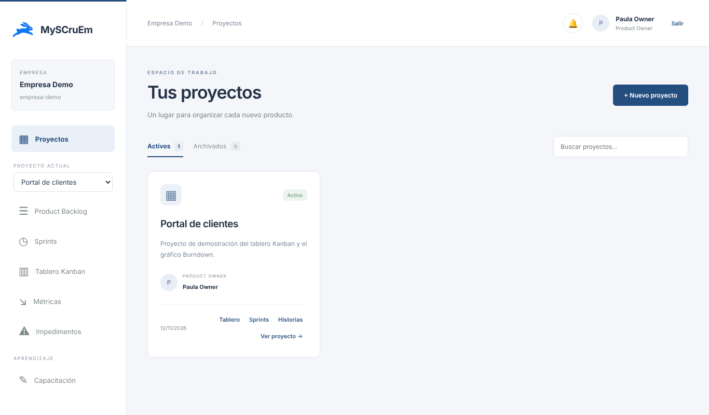
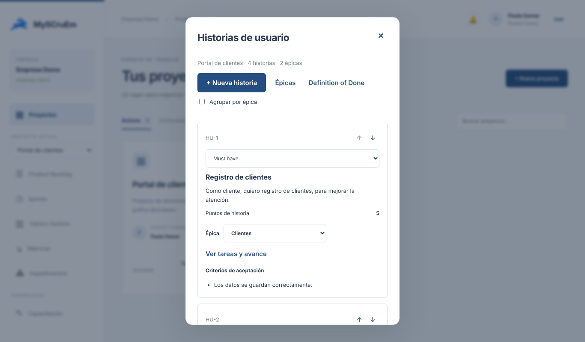
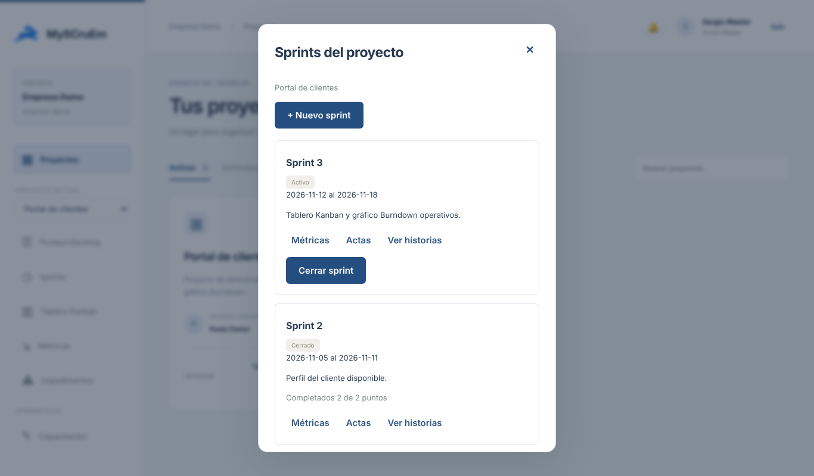
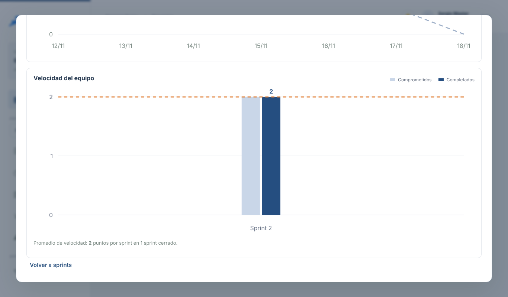
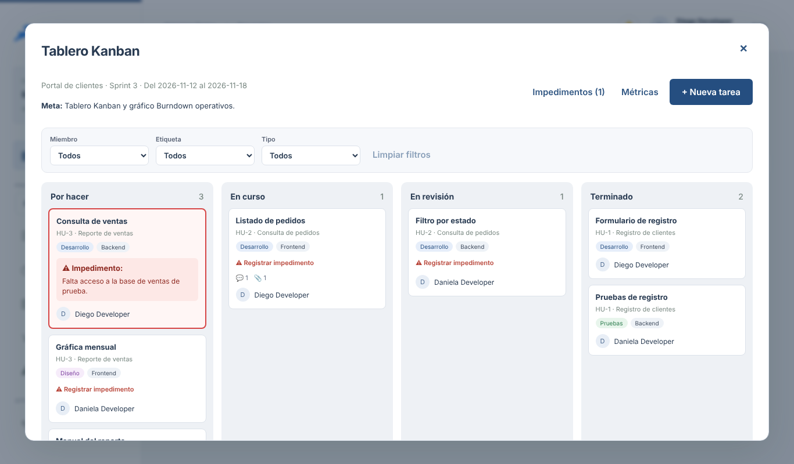
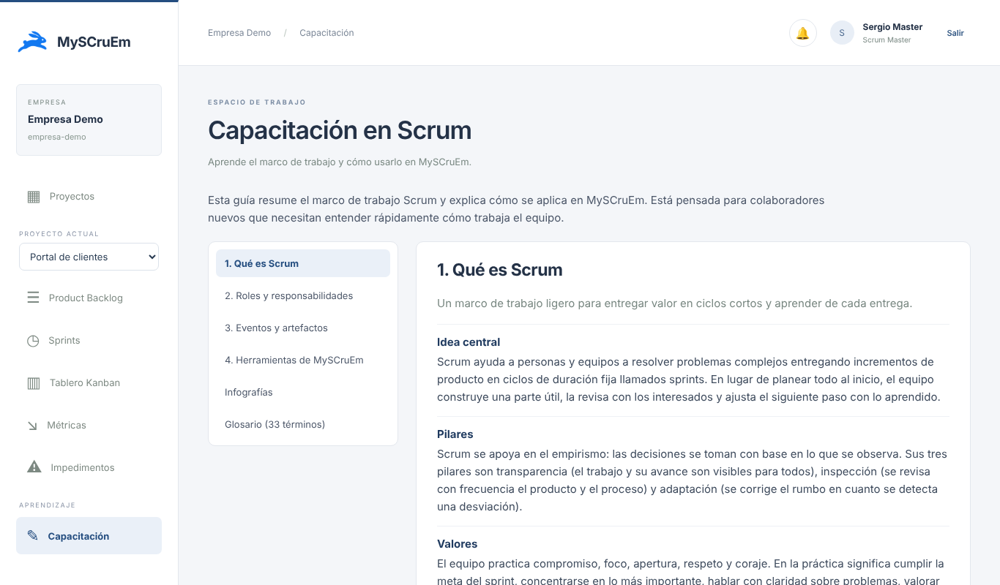

# Manual de usuario · MySCruEm

MySCruEm es una aplicación web para equipos que trabajan con Scrum. Se usa desde el navegador de una computadora. Este manual describe las tareas de cada rol.

## 1. Acceso

1. Abre la dirección de la aplicación en el navegador.
2. Escribe el código de la empresa, tu correo y tu contraseña, y pulsa **Acceder**.
3. Si tu empresa es nueva, usa **Registrar empresa**; la persona que la registra queda como administradora.

Al entrar verás **Mi panel**, con las opciones de tu rol, y la barra lateral con los proyectos en los que participas y sus secciones. El menú solo muestra lo que tu rol puede hacer. La primera vez se abre un recorrido por tu rol; puedes saltarlo y reabrirlo desde **? Ayuda** en el encabezado.

## 2. Administrador

- **Usuarios y roles**: invita usuarios con el rol de Product Owner, Scrum Master o Developer. La invitación genera un enlace para que la persona active su cuenta.
- **Equipos**: agrupa a los integrantes que trabajan en un proyecto. Cada equipo necesita al menos un Scrum Master, un Product Owner y un Developer.

## 3. Product Owner

- **Proyectos**: cualquier rol crea proyectos con **+ Nuevo proyecto**. Solo su creador o el Product Owner puede eliminarlo, después de confirmar; se borran también sus historias, sprints y tareas.
- **Product Backlog**: registra historias de usuario con actor, objetivo, beneficio y criterios de aceptación y la épica a la que pertenecen; edítalas o elimínalas, ordénalas con las flechas y asígnales prioridad. Los criterios se marcan con una casilla y la historia no pasa a Terminado mientras falte alguno.

- **Definition of Done**: desde el backlog, pulsa **Definition of Done** y escribe un criterio por línea (máximo 15). También puedes definir criterios propios de cada historia y de cada sprint. El equipo deberá confirmarlos antes de mover una tarea a Terminado.

## 4. Scrum Master

- **Equipos**: desde **Equipos** forma y ajusta los equipos de tus proyectos.
- **Épicas**: en el backlog crea las épicas con nombre, descripción y color.
- **Planning Poker**: abre la votación de una historia, revela los votos cuando todos hayan votado, pide otra ronda si no coinciden y guarda los puntos y horas acordados.
- **Sprints**: crea el sprint con nombre, fechas y meta, y define su capacidad en horas para compararla con lo comprometido; inícialo cuando tenga historias y ciérralo al terminar. Al cerrar, las historias incompletas regresan al backlog.

- **Actas**: en cada sprint pulsa **Actas** para registrar la Planning, la Daily, la Revisión o la Retrospectiva, con asistentes, notas y acuerdos. Solo tú puedes editarlas; el resto del equipo las consulta. Marca cada acuerdo cuando se atienda.

- **Impedimentos**: revisa los impedimentos abiertos y ciérralos escribiendo la solución. La pestaña **Historial completo** muestra también los cerrados.
- **Métricas**: elige el sprint o la vista general del proyecto y consulta el Burndown por puntos y por horas y la velocidad del equipo (puntos comprometidos y completados por sprint cerrado, con su promedio).

## 5. Developer

- **Mi panel**: muestra las historias del sprint activo.
- **Planning Poker**: elige en secreto tu carta para estimar cada historia.
- **Tablero Kanban**: crea tareas, filtra por integrante, etiqueta o tipo, y arrastra tus tarjetas entre Por hacer, En curso, En revisión y Terminado. Si el proyecto tiene Definition of Done, se pide confirmarla al mover a Terminado. Solo el responsable mueve su tarjeta y registra sus horas reales con **Registrar horas**.

- **Detalle de tarea**: haz clic en una tarjeta para ver y escribir comentarios y para adjuntar archivos (PDF, imágenes, texto u Office de hasta 5 MB). Solo el autor puede eliminar lo que subió.

- **Impedimentos**: usa **Registrar impedimento** en la tarjeta cuando algo bloquee el avance.

## 6. Todos los roles

- **Notificaciones**: la campana del encabezado muestra cuántos avisos no se han leído: asignaciones, cambios de estado de tus tareas e impedimentos resueltos.

- **Capacitación**: guía de Scrum, uso de MySCruEm, infografías y glosario con búsqueda. Marca cada sección al terminarla; la barra de avance indica cuando completaste el tutorial.

## 7. Datos de demostración

Con `npm run demo` se crea la empresa `empresa-demo` (contraseña `Demostracion2026`) con los usuarios admin@demo.test, po@demo.test, sm@demo.test, dev@demo.test y dev2@demo.test.
