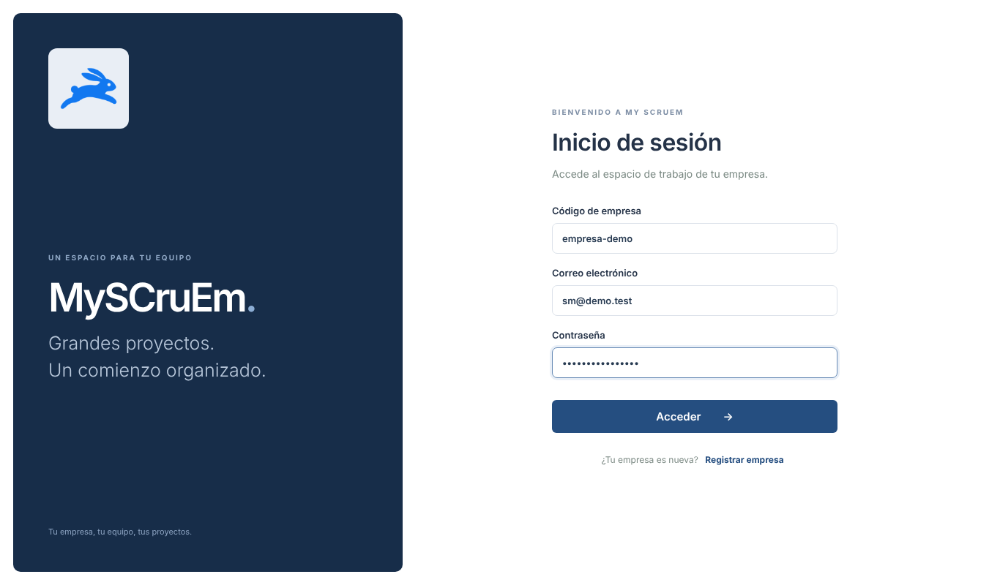
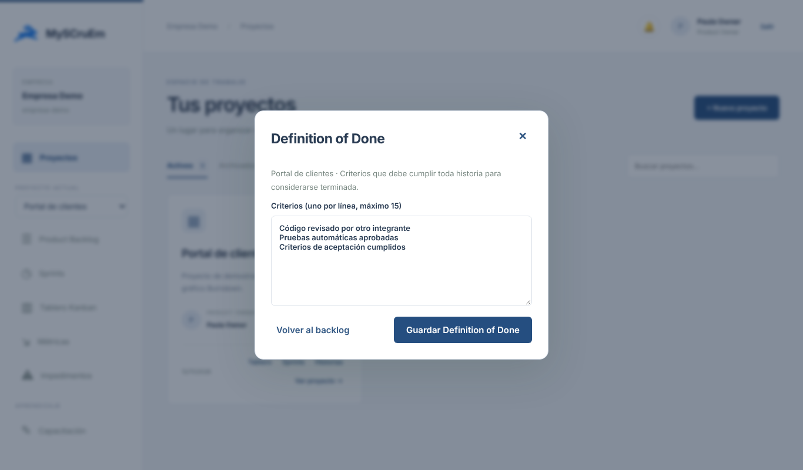
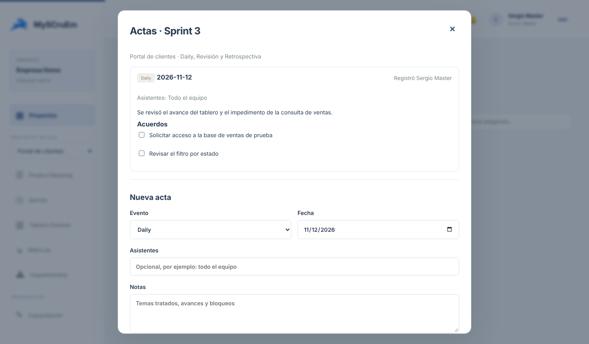
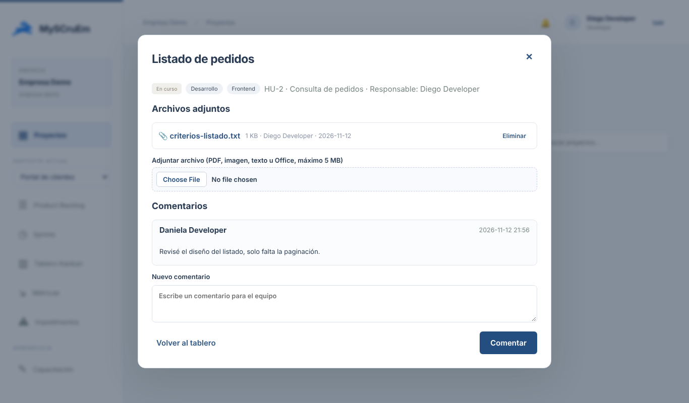
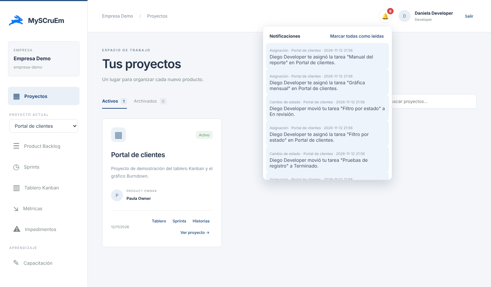

# Manual de usuario · MySCruEm

MySCruEm es una aplicación web para equipos que trabajan con Scrum. Se usa desde el navegador de una computadora. Este manual describe las tareas de cada rol.

## 1. Acceso

1. Abre la dirección de la aplicación en el navegador.
2. Escribe el código de la empresa, tu correo y tu contraseña, y pulsa **Acceder**.
3. Si tu empresa es nueva, usa **Registrar empresa**; la persona que la registra queda como administradora.

Al entrar verás la barra lateral con los proyectos, el proyecto actual y sus secciones: Product Backlog, Sprints, Tablero Kanban, Métricas, Impedimentos y Capacitación.

## 2. Administrador

- **Usuarios y roles**: invita usuarios con el rol de Product Owner, Scrum Master o Developer. La invitación genera un enlace para que la persona active su cuenta.
- **Equipos**: agrupa a los integrantes que trabajan en un proyecto.

## 3. Product Owner

- **Proyectos**: crea, edita y archiva proyectos con **+ Nuevo proyecto**.
- **Product Backlog**: registra historias de usuario con actor, objetivo, beneficio y criterios de aceptación; ordénalas con las flechas, asígnales prioridad y agrúpalas en épicas.

- **Definition of Done**: desde el backlog, pulsa **Definition of Done** y escribe un criterio por línea (máximo 15). El equipo deberá confirmarlos antes de mover una tarea a Terminado.

## 4. Scrum Master

- **Sprints**: crea el sprint con nombre, fechas y meta; inícialo cuando tenga historias y ciérralo al terminar. Al cerrar, las historias incompletas regresan al backlog.

- **Actas**: en cada sprint pulsa **Actas** para registrar la Daily, la Revisión o la Retrospectiva, con asistentes, notas y acuerdos. Marca cada acuerdo cuando se atienda.

- **Impedimentos**: revisa los impedimentos abiertos y ciérralos escribiendo la solución.
- **Métricas**: consulta el gráfico Burndown del sprint y la velocidad del equipo (puntos comprometidos y completados por sprint cerrado, con su promedio).

## 5. Developer

- **Estimación**: asigna puntos de historia a las historias del backlog.
- **Tablero Kanban**: crea tareas, filtra por integrante, etiqueta o tipo, y arrastra las tarjetas entre Por hacer, En curso, En revisión y Terminado. Si el proyecto tiene Definition of Done, se pide confirmarla al mover a Terminado.

- **Detalle de tarea**: haz clic en una tarjeta para ver y escribir comentarios y para adjuntar archivos (PDF, imágenes, texto u Office de hasta 5 MB). Solo el autor puede eliminar lo que subió.

- **Impedimentos**: usa **Registrar impedimento** en la tarjeta cuando algo bloquee el avance.

## 6. Todos los roles

- **Notificaciones**: la campana del encabezado muestra cuántos avisos no se han leído: asignaciones, cambios de estado de tus tareas e impedimentos resueltos.

- **Capacitación**: guía de Scrum, uso de MySCruEm, infografías y glosario con búsqueda.

## 7. Datos de demostración

Con `npm run demo` se crea la empresa `empresa-demo` (contraseña `Demostracion2026`) con los usuarios admin@demo.test, po@demo.test, sm@demo.test, dev@demo.test y dev2@demo.test.
